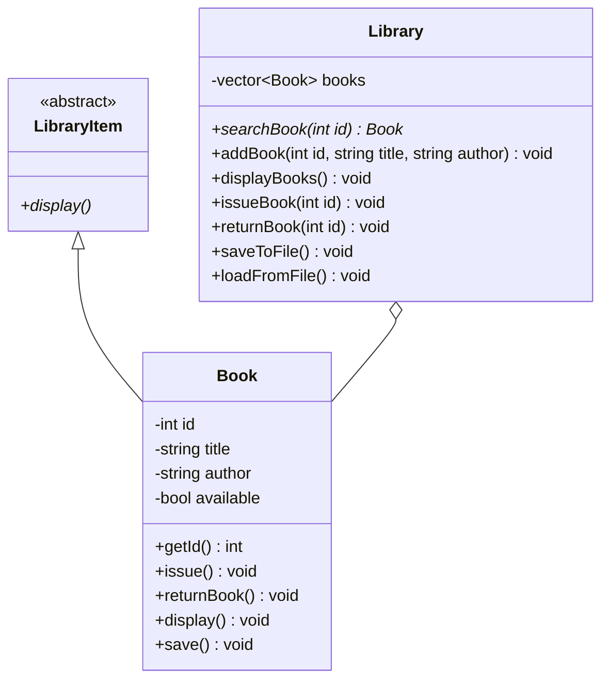

# UML Class Diagram – Library Management System

## Class Description

1. **LibraryItem:** Abstract base class containing the virtual display function.
2. **Book:** Derived class that stores book details and manages issue and return operations.
3. **Library:** Manages book records using a vector and provides search, display and file-handling operations.

## Relationships

- Book inherits from LibraryItem.
- Library manages multiple Book objects.
